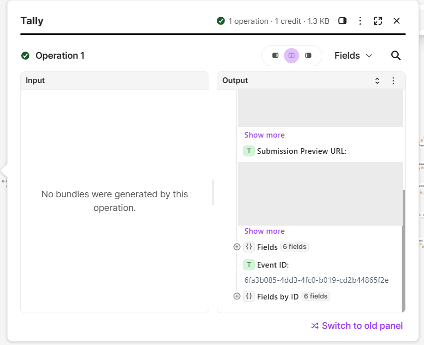

# בונוס 2: ייבוא אוטומציה שמישהו אחר בנה

**סטטוס: הוגש** (יובא ל-Make והופעל. הטופס מגיע ל-Make, וההרצה המלאה עוד לא עוברת את המסננים. פירוט למטה.)

## המקור
האוטומציה **Integration Tally** נבנתה על ידי חברה מהקורס, וקיבלתי ממנה את קובץ ה-JSON.
הקובץ בריפו: [`bonus2/integration-tally.blueprint.json`](bonus2/integration-tally.blueprint.json)
(הסרתי ממנו את כתובת המייל של החברה, את מזהי הגיליונות שלה ואת ערוץ ה-Slack. במקומם יש ערכים כמו `YOUR_SPREADSHEET_OR_FOLDER_ID`.)

## מה האוטומציה עושה
טיפול אוטומטי בלידים לייעוץ משכנתאות:
1. **Tally: Watch new responses**: מתחילה כשמישהו ממלא טופס (שם, טלפון, אימייל, סוג שירות, הערות, אישור דיוור).
2. **Set variables**: מנקה את האימייל ומוציאה את סוג השירות.
3. **מסנן 1**: ממשיך רק אם האימייל תקין והטלפון הוא 9–10 ספרות.
4. **Google Sheets: Search rows + מסנן 2**: בודק שהפנייה איננה כפילות.
5. **Google Sheets: Add a row**: רושם כל פנייה ביומן פניות, ואיש קשר חדש בגיליון אנשי קשר.
6. **Router לפי סוג השירות** (מחזור משכנתא, מחיר למשתכן, משכנתא חדשה, מימון לקבלן VIP, אחר): בכל מסלול נשלח **מייל לבעלת העסק** ו**מייל תודה מותאם ללקוח** דרך Gmail. במסלול VIP נשלחת גם **הודעה ל-Slack**.

## מה עשיתי
1. ייבאתי את הקובץ ל-Make: Create a new scenario ← ⋯ ← **Import Blueprint**.
2. בניתי טופס משלי ב-Tally וחיברתי אותו למודול הראשון במקום הטופס של החברה.
3. מילאתי את הטופס: Make קיבל את הפנייה בהצלחה, והמודול הראשון רץ עם 6 השדות של הטופס:

## מה עוד לא עובד
ההרצה נעצרת במסנן הראשון, בלי שורה בגיליון ובלי מייל. הסיבה: המודול Set variables ומסנן 1 מחפשים את השדות לפי **מזהי השדות של הטופס של החברה** (`fieldsById`). בטופס שלי המזהים אחרים, ולכן האימייל יוצא ריק. כדי שהכול ירוץ צריך:
- לחבר מחדש את שדות האימייל, הטלפון וסוג השירות לשדות של הטופס שלי.
- לתקן במסנן 2 את התגית `TEXT` ל-`7.text` (זו טעות שהייתה כבר בקובץ המקורי).
- לבחור גיליונות Google Sheets שלי בארבעת מודולי ה-Sheets, ולמחוק את מודול ה-Slack.

## מה למדתי
ייבוא של Blueprint מעביר את כל הלוגיקה (מודולים, מסננים, Router ונוסחאות), אבל לא את החיבורים ולא את מבנה הנתונים של מי שבנה אותו. כל מקום שמפנה לשדה לפי מזהה, או לגיליון ספציפי, צריך לחבר מחדש.
