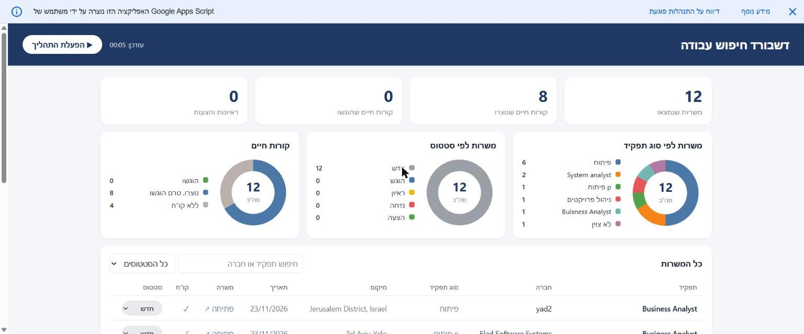

# משימת בונוס 1: אוטומציה לדאשבורד

> **המשימה:** יצירת אוטומציה לדאשבורד שכבר בניתם, למשל אוטומציה שמעדכנת את בסיס הנתונים שלכם באיירטייבל או בגוגל שיטס.

**סטטוס: הוגש.**

## מה בניתי

דאשבורד למעקב אחרי חיפוש עבודה: כמה משרות נמצאו, כמה קורות חיים מותאמים נוצרו וכמה הוגשו, ופילוח לפי סוג תפקיד ולפי סטטוס.

- **בסיס הנתונים:** Google Sheets, קובץ "חיפוש עבודה", לשונית `גיליון1` (במקום Airtable, כדי לעבוד על חשבונות חינמיים).
- **הדאשבורד:** לשונית `דשבורד` באותו קובץ.
- **האוטומציה:** תרחיש ב-Make.com (`process-linkedin-job-documents.blueprint.json` בריפו הזה), שמעדכן את בסיס הנתונים בכל פעם שמגיע מייל משרות.

## דשבורד בדפדפן

**קישור:** https://script.google.com/macros/s/AKfycbyNZaFYrCRvWz0t6QNS0TpN3Iuo2x-a0TVh5fZQssUe5mMu8THdLVVDNaq8LZpLYaeZ/exec (פתוח רק לחשבון שלי)



דף אינטרנט (Google Apps Script Web App) שמחובר ישירות לגיליון "חיפוש עבודה":
- **כרטיסי סיכום:** משרות שנמצאו, קורות חיים שנוצרו, קורות חיים שהוגשו, ראיונות והצעות.
- **3 גרפי עוגה:** משרות לפי סוג תפקיד, משרות לפי סטטוס, מצב קורות החיים.
- **טבלת כל המשרות** עם חיפוש וסינון. בכל שורה יש רשימה נפתחת של סטטוס, ובחירה בה נכתבת מיד לעמודת "סטטוס" ב`גיליון1` (`setJobStatus`).
- **כפתור "הפעלת התהליך"** בראש הדף מפעיל את תרחיש ה-Make (`runMakeScenario`, דרך Make API) ואחרי דקה-שתיים מרענן את הנתונים. דורש טוקן API של Make בשם `MAKE_TOKEN` במאפייני הסקריפט.
- הנתונים נקראים חי מהגיליון (`getJobs`) ומתרעננים כל דקה, כך שמשרות חדשות ש-Make מוסיף מופיעות לבד.

קבצים: `dashboard.html` (עיצוב הדף), `dashboard-status.gs` (צד השרת: `doGet`, `getJobs`, `setJobStatus`, וגם לשונית הדשבורד בגיליון).

## איך האוטומציה מעדכנת את הדאשבורד

```
מייל התראת משרות מ-LinkedIn (Gmail)
  ← AI ב-Make מחלץ את המשרות: תפקיד, חברה, מיקום, קישור, סוג תפקיד, דרישות
  ← AI כותב קורות חיים מותאמים ושומר ב-Google Docs
  ← Google Sheets: Add a row, שורה חדשה בגיליון1 עם סטטוס "חדש"
  ← לשונית "דשבורד" מתעדכנת מיד
```

ובכיוון ההפוך: שינוי סטטוס ברשימה הנפתחת בדאשבורד ← Apps Script כותב אותו לגיליון1.

הנוסחאות בדאשבורד מתעדכנות מיד, ורשימת המשרות מתרעננת כל 5 דקות.

## בסיס הנתונים: לשונית `גיליון1`

| עמודה | מי ממלא |
|---|---|
| תפקיד, חברה, מיקום, קישור למשרה, דרישות, סוג תפקיד | Make (חילוץ AI) |
| תאריך | Make |
| קורות חיים | Make (שם קובץ קורות החיים המותאמים) |
| סטטוס | Make מכניס "חדש", ואני מעדכנת מרשימה נפתחת: חדש / הוגש / ראיון / נדחה / הצעה |

סוגי התפקידים נקבעים בפרומפט של ה-AI: פיתוח, דאטה, מוצר, QA, ניהול פרויקטים, אחר.

## הדאשבורד: לשונית `דשבורד`

כל הנוסחאות מוצאות את העמודה לפי שם הכותרת (`INDEX` + `MATCH`), כך שהן ממשיכות לעבוד גם אם העמודות זזות.

### 3 גרפי עוגה בראש הדשבורד (שורות 1-20)

1. **משרות לפי סוג תפקיד**
2. **משרות לפי סטטוס**
3. **קורות חיים:** הוגשו / נוצרו וטרם הוגשו / ללא קו"ח (טבלת עזר ב-D33:E36)

הגרפים נבנים על ידי `setupDashboard()` בסקריפט ומתעדכנים לבד מהטבלאות שמתחתם. הטבלאות והרשימה מתחילות בשורה 21, ולכן מספרי התאים בהמשך מוסטים ב-20 שורות (למשל D1 הופך ל-D21).

### רשימת כל המשרות עם עדכון סטטוס (עמודות H-M, משורה 21)

הלשונית `דשבורד` מציגה את כל המשרות (תפקיד, חברה, סוג תפקיד, תאריך, קישור, סטטוס), ובעמודת הסטטוס יש רשימה נפתחת. שינוי סטטוס בדשבורד נכתב אוטומטית חזרה לבסיס הנתונים ב`גיליון1`, ומשם מתעדכנים גם המונים והסיכומים.

זה נעשה עם Apps Script שמחובר לגיליון (`dashboard-status.gs` בריפו הזה):
- `onEdit`: כששמשנים סטטוס בדשבורד, הסקריפט מוצא את השורה המקורית (עמודה G מוסתרת שומרת את מספר השורה) ומעדכן את עמודת "סטטוס" ב`גיליון1`. עריכה ב`גיליון1` מרעננת את הרשימה.
- `refreshJobs`: מעתיק את כל המשרות מ`גיליון1` לדשבורד ומוסיף את הרשימה הנפתחת. רץ אוטומטית כל 5 דקות (טריגר זמן), כדי לקלוט משרות חדשות ש-Make מוסיף, וגם מתפריט "דשבורד" בגיליון.

### משרות לפי סוג תפקיד (עמודות A-B)

תא A2, רשימת סוגי התפקידים:
```
=UNIQUE(FILTER(INDEX('גיליון1'!A2:Z,0,MATCH("סוג תפקיד",'גיליון1'!A1:Z1,0)),INDEX('גיליון1'!A2:Z,0,MATCH("סוג תפקיד",'גיליון1'!A1:Z1,0))<>""))
```
תא B2, מספר המשרות לכל סוג:
```
=BYROW(A2:A,LAMBDA(r,IF(r="",,COUNTIF(INDEX('גיליון1'!A2:Z,0,MATCH("סוג תפקיד",'גיליון1'!A1:Z1,0)),r))))
```

### משרות לפי סטטוס (D1:E6)

בתאים D2 עד D6: חדש, הוגש, ראיון, נדחה, הצעה. בתא E2, ומועתק עד E6:
```
=COUNTIF(INDEX('גיליון1'!$A$2:$Z,0,MATCH("סטטוס",'גיליון1'!$A$1:$Z$1,0)),D2)
```

### סיכום (D8:E10)

| מדד | נוסחה |
|---|---|
| סה"כ משרות | `=COUNTA(INDEX('גיליון1'!A2:Z,0,MATCH("תפקיד",'גיליון1'!A1:Z1,0)))` |
| קו"ח שנוצרו | `=COUNTA(INDEX('גיליון1'!A2:Z,0,MATCH("קורות חיים*",'גיליון1'!A1:Z1,0)))` |
| קו"ח שהוגשו | `=SUM(E3:E6)`, כל משרה שעברה את "חדש" (הוגש, ראיון, נדחה, הצעה) |

## תמונת מצב (25.11.2026)

- 12 משרות נקלטו, 8 קורות חיים מותאמים נוצרו, 0 הוגשו עד כה.
- סוגי תפקידים: פיתוח 6, ניהול פרויקטים 1, ועוד כמה ערכים שה-AI החזיר משובשים וצריך לתקן בגיליון1.
