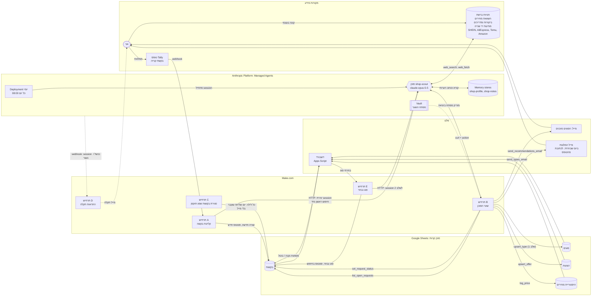
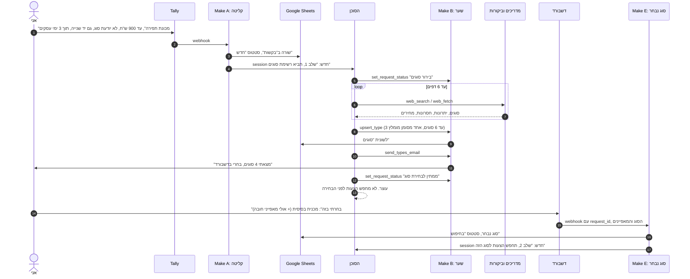
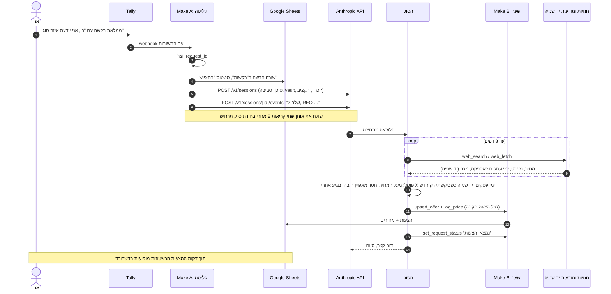
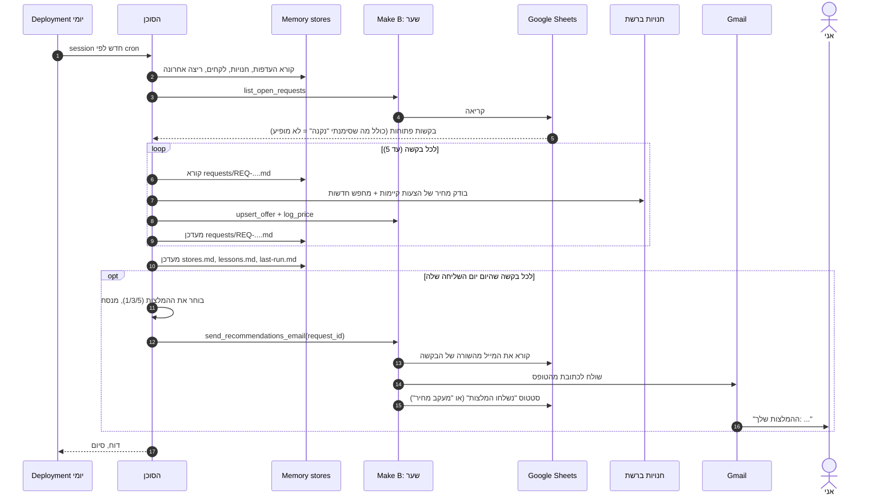
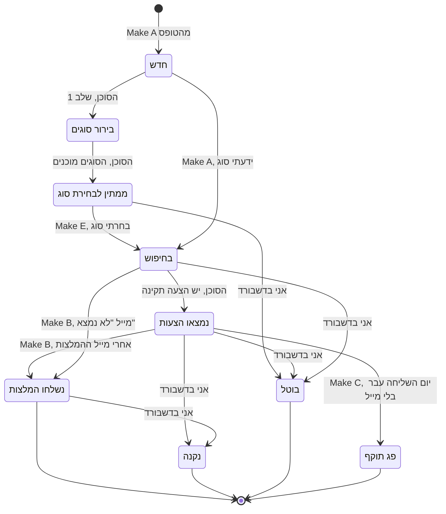
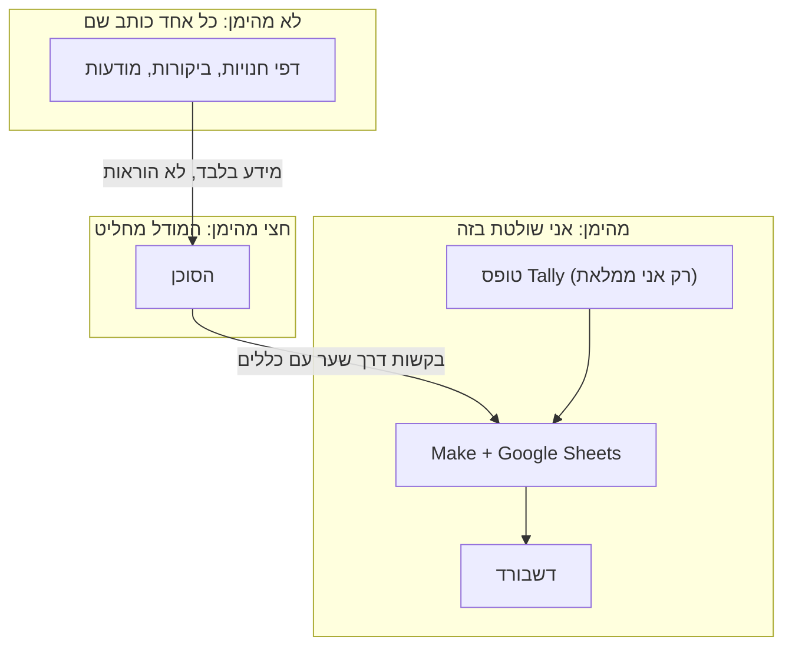

# Architecture: "סוכן הקניות"

> תרגיל שיעור 6, שאלה 4: מה מפעיל את הסוכן, מה עושים עם הפלט, ותרשים זרימת המידע של כל המערכת.
>
> קבצים נלווים: [SPEC.md](SPEC.md) (תכנון הסוכן) · [CONFIG.md](CONFIG.md) (קונפיגורציה).

---

## 1. המערכת בפסקה אחת

אני ממלאת **[טופס Tally](https://tally.so/r/QoVkZG)** לכל דבר שאני רוצה לקנות (מספיק שם מוצר). **Make** קולט את הטופס, כותב שורה ל-**Google Sheets** ומפעיל את **הסוכן** ב-**Anthropic Platform (Managed Agents)**. **שלב 1:** אם לא ידעתי איזה סוג, הסוכן מביא רשימת סוגים של המוצר, ואני בוחרת סוג בדשבורד. **שלב 2:** הסוכן מחפש הצעות לסוג שבחרתי, בחנויות ובמודעות יד שנייה אם ביקשתי, ודרך **שער ב-Make** כותב הצעות ומחירים לגיליון. **כל בוקר** הוא חוזר לבקשות הפתוחות, ו**ביום שבחרתי בטופס** (היום עד 5 ימים, ברירת מחדל 3) שולח מייל עם ההמלצות לכתובת שמילאתי בטופס, ומפסיק לחפש לבקשה. **הדשבורד** (Apps Script, כמו בתרגיל 4) מציג הכול ומאפשר לי לסמן "נקנה".

**החלוקה:**
- **Make** = הצעדים הקבועים: קליטה, כתיבה לגיליון, מייל, אכיפת כללים.
- **הסוכן** = שיקול הדעת: איפה לחפש, מה לבדוק, מה לדרג.
- **Google Sheets** = מסד הנתונים שכולם חולקים.
- **אני** = ההחלטה והקנייה.

---

## 2. תרשים המערכת

**מקרא:** חץ מלא = זרימת מידע רגילה · חץ מקווקו = סודות או התראות · `<-->` = קריאה ותשובה.

---

## 3. מה מפעיל את הסוכן (טריגרים)

לסוכן יש **שלושה טריגרים**: שניים מ-Make (טופס, בחירת סוג) ואחד מהפלטפורמה של Anthropic (תזמון יומי). **אין מייל קבוע ביום שישי:** כל בקשה נשלחת ביום שבחרתי לה בטופס.

| # | טריגר | איפה מוגדר | מתי | ההודעה הראשונה ל-session | למה |
|---|---|---|---|---|---|
| 1 | **בקשה חדשה** | Make, תרחיש A (HTTP module ל-Anthropic API) | מיד כשהטופס נשלח | לא ידעתי סוג: "בקשה חדשה REQ-...: שלב 1, תביא רשימת סוגים". ידעתי סוג: "בקשה חדשה REQ-...: שלב 2, תחפש הצעות" | לא לחכות למחר. תוך כמה דקות יש סוגים או הצעות בדשבורד |
| 4 | **בחרתי סוג** | Make, תרחיש E (webhook מכפתור "בחרתי בזה" בדשבורד) | מיד כשאני בוחרת | "REQ-...: נבחר הסוג X. שלב 2, תחפש הצעות לסוג הזה בלבד." | ההחלטה שלי היא נקודת בקרה: הסוכן מחפש מחירים רק אחרי שאישרתי מה לחפש |
| 2 | **ריצה יומית** | Anthropic, Deployment `shop-daily` | כל יום, 08:00 שעון ישראל (עד ~9 דקות אחרי) | "ריצה יומית: תבדוק את כל הבקשות הפתוחות, ותשלח מייל לבקשות שהיום יום השליחה שלהן" | מחירים ומלאי משתנים, ולכל בקשה יש יום שליחה משלה |

**למה טריגר 1 ב-Make ולא בפלטפורמה?** הטופס של Tally יודע לשלוח webhook רק לכתובת אחת, ו-Make כבר מחובר אליו (מבונוס 2). Make גם כותב את השורה לגיליון **לפני** שהסוכן מתחיל, כך שהבקשה קיימת גם אם הסוכן נכשל.

**למה טריגר 4 דרך Make ולא ישר מהדשבורד?** כדי שמפתח ה-API של Anthropic יישב רק במקום אחד (Make), ולא גם ב-Apps Script. Make גם כותב את הבחירה לגיליון לפני שהסוכן מתחיל.

**למה טריגר 2 בפלטפורמה ולא ב-Make?** Deployment שומר רשומה של כל הפעלה, כולל הפעלות שנכשלו, ואפשר להשהות אותו בלי למחוק. זה "שעון מעורר" שמחובר ישירות לסוכן.

### ומה **לא** מפעיל את הסוכן

- **מייל שיווקי מחנות** לא מפעיל אותו. זה היה פותח פתח ל-prompt injection (כל אחד יכול לשלוח לי מייל).
- **שינוי בגיליון** לא מפעיל אותו. סימון "נקנה" פשוט נקרא בריצה הבאה.

---

## 4. מה עושים עם הפלט

| פלט | נוצר ע"י | הולך ל | מי משתמש | מה עושים איתו |
|---|---|---|---|---|
| **רשימת סוגים** (שלב 1) | הסוכן → שער B | לשונית `סוגים` | דשבורד | **אני בוחרת סוג**, וזה מפעיל את שלב 2 |
| **מייל "הסוגים מוכנים"** | הסוכן → שער B → Gmail | תיבת המייל שלי | אני | קישור לדשבורד כדי לבחור |
| **הצעות** (שורות בגיליון) | הסוכן → שער B | לשונית `הצעות` | דשבורד, מייל ההמלצות | השוואה, החלטה |
| **היסטוריית מחירים** | הסוכן → שער B | לשונית `היסטוריית מחירים` | דשבורד (גרף) | לראות אם המחיר יורד לפני שקונים |
| **סטטוס בקשה** | הסוכן → שער B / אני בדשבורד / תרחיש C | לשונית `בקשות` | כולם | הסוכן יודע מה עוד פתוח |
| **מייל ההמלצות** (ביום השליחה של הבקשה) | הסוכן מנסח → שער B שולח מ-Gmail | הכתובת שמילאתי בטופס (Make לוקח אותה מהשורה, לא מהסוכן) | אני | **אני קונה** בקישור מהמייל, ומסמנת "נקנה" |
| **הערות במחברת** | הסוכן | memory store `shop-notes` | הסוכן בריצה הבאה | לא לחזור על חיפוש שכבר נעשה, להתרחק מחנויות חשודות |
| **דוח ריצה** (ההודעה האחרונה של ה-session) | הסוכן | תמליל ה-session בקונסולה | אני, כשבודקת | מעקב, דיבאג |
| **התראת תקלה** | Anthropic webhook → Make D | המייל שלי | אני | לתקן (למשל לחבר מחדש את Google ב-Make) |

---

## 5. הזרימות צעד אחר צעד

### 5.1 בקשה חדשה מהטופס, שלב 1: רשימת סוגים

### 5.2 שלב 2: חיפוש הצעות (אחרי בחירת סוג, או ישר מהטופס כשידעתי סוג)

### 5.3 ריצה יומית ויום השליחה

### 5.4 מחזור החיים של בקשה

**השער של Make אוכף:** הסוכן יכול לבצע רק את המעברים שכתוב לידם "הסוכן". כל מעבר אחר נדחה. בריצה היומית, בקשה ב"ממתין לבחירת סוג" לא נחפשת, ובמייל שלה ביום השליחה תופיע תזכורת לבחור סוג.

---

## 6. הרכיבים

| רכיב | טכנולוגיה | תפקיד | הרשאות |
|---|---|---|---|
| טופס | Tally (חינמי) | קליטת בקשה | — |
| תרחיש A: קליטת בקשה | Make: Webhooks → Tools (set variable: request_id) → Google Sheets Add a Row → HTTP (create session) → HTTP (send event) | בקשה → גיליון → סוכן | Sheets: גיליון אחד · Anthropic API key בחיבור של Make |
| תרחיש B: שער הסוכן | Make: Webhooks (עם API key) → Router לפי `action` → Sheets Search/Add/Update · Gmail Send · Webhook response | הידיים של הסוכן בגיליון ובמייל | Sheets: גיליון אחד · Gmail: שליחה רק לכתובת שבשורת הבקשה, ורק אם היא ברשימת הכתובות המותרות |
| תרחיש C: בדיקה לילית | Make: Schedule 02:00 → Sheets Search (יום שליחה עבר ועדיין לא "נשלחו המלצות") → Update סטטוס "פג תוקף" → Gmail התראה לי | רשת ביטחון אם מייל לא יצא | Sheets |
| תרחיש E: סוג נבחר | Make: Webhooks ← כפתור "בחרתי בזה" בדשבורד → Sheets Update (סוג נבחר, מאפיינים, סטטוס "בחיפוש") → HTTP (create session) → HTTP (send event "שלב 2") | הבחירה שלי → שלב 2 | Sheets · Anthropic API key בחיבור של Make |
| תרחיש D: התראות | Make: Webhooks ← Anthropic webhook (`session.status_idled` עם שגיאה / תקציב) → Gmail | לדעת כשמשהו נשבר | Gmail לעצמי |
| מסד נתונים | Google Sheets "סוכן קניות" (4 לשוניות: בקשות, סוגים, הצעות, היסטוריית מחירים) | העולם המשותף | — |
| הסוכן | Anthropic Managed Agents: Agent `shop-scout` | שיקול הדעת | ראו [CONFIG.md](CONFIG.md) |
| סביבה | Environment `shop-cloud` (ענן Anthropic) | החדר שהכלים רצים בו | רשת פתוחה (חייב לחפש בכל החנויות) |
| מפתחות | Vault `shop-vault` | מפתח השער | מוזרק רק ל-`hook.eu1.make.com` |
| זיכרון | Memory stores `shop-profile` (קריאה), `shop-notes` (קריאה+כתיבה) | המחברת | — |
| תזמון | Deployments `shop-daily` | השעון המעורר | — |
| דשבורד | Google Apps Script web app (כמו בתרגיל 4) | תצוגה + סימון "נקנה" | קורא וכותב לאותו גיליון |

### הדשבורד

אותו רעיון כמו דשבורד חיפוש העבודה שכבר בניתי (ראו [DASHBOARD.md](../DASHBOARD.md)):

- **כרטיסים למעלה:** בקשות פתוחות · הצעות שנמצאו השבוע · כמה חסכתי (מחיר מקסימלי פחות מחיר ההמלצה).
- **בקשה שממתינה לבחירת סוג:** כרטיס לכל סוג (יתרונות, חסרונות, טווח מחיר, "מתאים לך אם", תגית "מומלץ") עם כפתור **"בחרתי בזה"** ושדה להוספת מאפייני חובה.
- **רשימת בקשות** עם סטטוס שאפשר לשנות (`נקנה` / `בוטל`), שנכתב חזרה לגיליון.
- **לכל בקשה:** טבלת ההצעות לפי ציון (עם תגית "חדש" / "יד שנייה" וימי עסקים לאספקה), וגרף קטן של המחיר לאורך השבוע מ"היסטוריית מחירים".
- **כפתור "בקשה חדשה"** שפותח את טופס Tally.

---

## 7. גבולות אמון (מי סומך על מי)

- **מה שנכנס מהרשת** הוא מידע לא מהימן. לכן לסוכן אין ידיים מסוכנות, והכללים נאכפים ב-Make.
- **הקישור לטופס** לא מפורסם, כדי שרק אני אמלא אותו. (אפשר להוסיף שדה סיסמה פשוט ב-Tally, ו-Make בודק אותו.)

---

## 8. עלויות (הערכה)

| רכיב | עלות |
|---|---|
| Tally, Google Sheets, Apps Script | חינם |
| Make (בתוכנית החינמית יש מכסה חודשית של כ-1,000 פעולות) | ~5 ריצות × 25 קריאות לשער + קליטה + סגירה ≈ 700 פעולות בחודש. **צמוד לגבול החינמי**. אם עובר: לצמצם את `log_price` רק לשינוי מחיר |
| Anthropic | עד 1.50$ ליום × 30 + בקשות חדשות ≈ **עד 50$ לחודש** בתקרה. בפועל פחות, כי בימים בלי בקשות פתוחות הריצה קצרה |

> כדי לחסוך: כשאין בקשות פתוחות, אפשר להשהות את ה-deployments (Pause) ולהפעיל מחדש עם בקשה חדשה.
